<p align="center">
  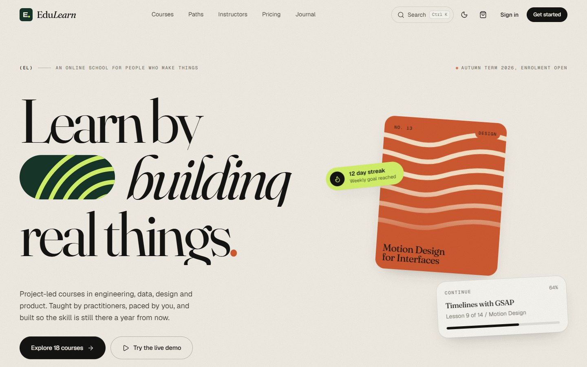
</p>

<h1 align="center">EduLearn</h1>

<p align="center">
  A project-led learning platform with a real classroom, progress tracking, graded knowledge checks and verifiable certificates.
</p>

<p align="center">
  <a href="https://edulearn-rm.vercel.app"><b>Live demo</b></a>
  &nbsp;&middot;&nbsp;
  <a href="#a-tour-of-the-product">Product tour</a>
  &nbsp;&middot;&nbsp;
  <a href="#under-the-hood">Under the hood</a>
  &nbsp;&middot;&nbsp;
  <a href="#getting-started">Getting started</a>
</p>

> **No sign-up needed.** On the sign-in page choose **Continue with the demo account**. It opens a learner account that already has courses in progress, a learning streak, an order history and a certificate, so every part of the product can be explored straight away.

---

## At a glance

| | |
| --- | --- |
| **Catalogue** | 18 courses across 8 subjects, 9 instructors, 4 career paths and 6 journal articles |
| **Learning** | Lesson player, reading and project lessons, autosaving notes, graded quizzes, certificates |
| **Progress** | Streaks, weekly goals, a 12-week activity heatmap and per-course progress, synced to MongoDB |
| **Commerce** | Cart, wishlist, coupon codes and a demo checkout with card, UPI and PayPal options |
| **Experience** | GSAP and Lenis motion, page transitions, light and dark themes, a Ctrl K command palette |
| **Stack** | React 19, React Router 8, Vite 8, Tailwind CSS 4, Express 5, Mongoose 9, JWT |

---

## A tour of the product

### The landing page

An editorial layout built on paper and ink tones, deep forest surfaces and a single lime accent, set in Fraunces and Geist. Headlines rise out of masks line by line, a pill of course covers rotates inside the headline, and floating product cards lean toward the pointer.

Every course cover is generated in code from its subject's palette and a seeded geometric motif, so the whole catalogue reads like one printed series instead of a collection of stock photos.

<table>
  <tr>
    <td width="50%">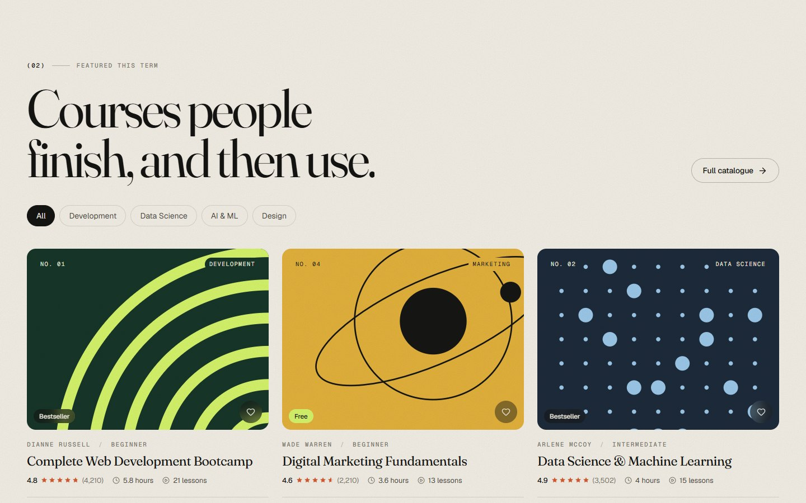</td>
    <td width="50%">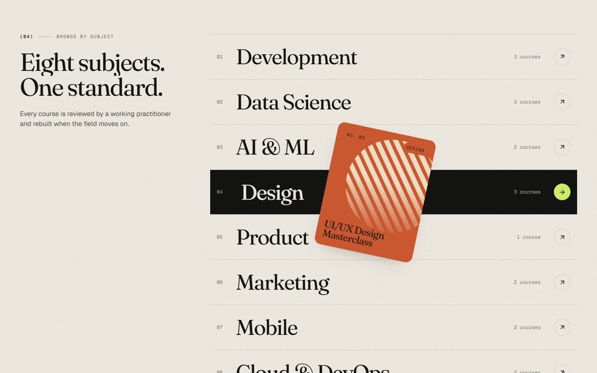</td>
  </tr>
  <tr>
    <td><sub>Featured courses. Switching subjects animates the grid with GSAP Flip.</sub></td>
    <td><sub>Browse by subject. Hovering a row floats a cover preview that follows the pointer.</sub></td>
  </tr>
</table>

The "How it works" section pins to the viewport and turns vertical scrolling into a horizontal walk through four steps, each with its own small product illustration.

<p align="center">
  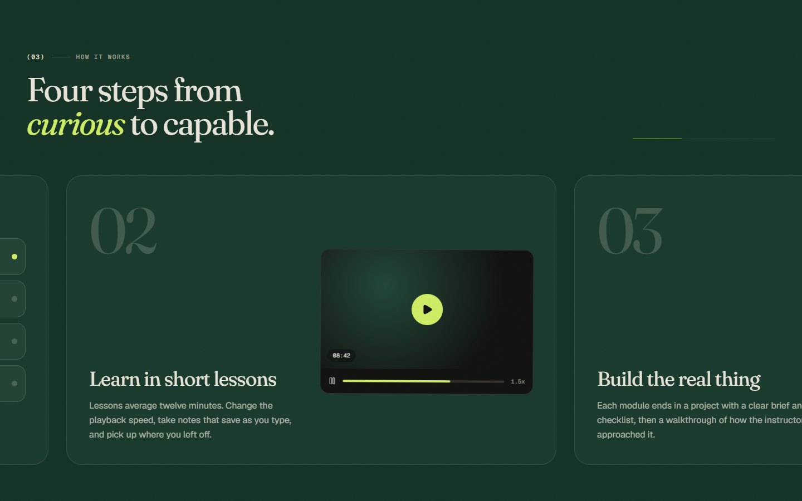
</p>

### Finding a course

The catalogue combines search with filters for subject, level, length, rating and price, plus sorting and grid or list views. Every choice is written to the URL, so a filtered view can be bookmarked or shared.

<p align="center">
  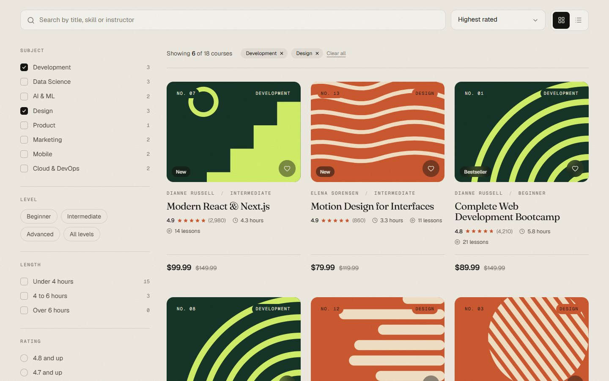
</p>

A command palette opens from anywhere with <kbd>Ctrl</kbd> + <kbd>K</kbd> (or <kbd>Cmd</kbd> + <kbd>K</kbd>). It searches courses, learning paths, instructors, articles and pages, and works entirely from the keyboard.

<p align="center">
  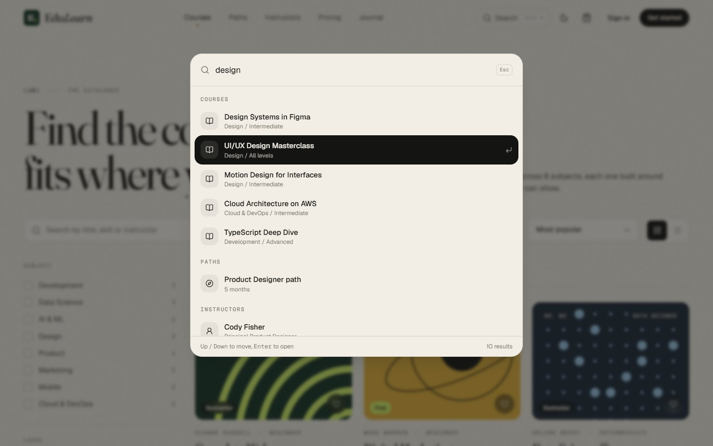
</p>

### The course page

Each course has a full landing page: outcomes, skills, requirements, an expandable curriculum, the instructor, a rating breakdown with learner reviews, and a sticky purchase card. Section tabs follow your scroll position.

<table>
  <tr>
    <td width="50%">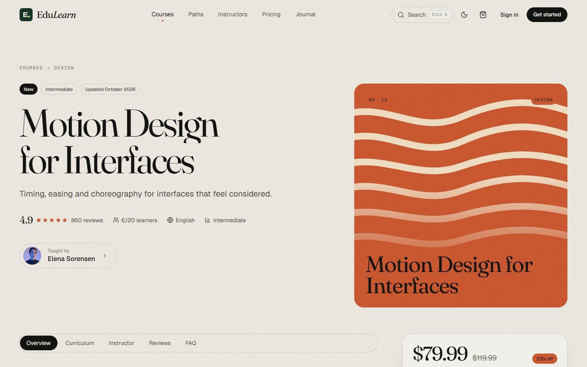</td>
    <td width="50%">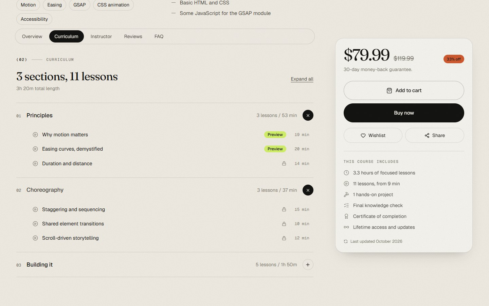</td>
  </tr>
  <tr>
    <td><sub>Course header with ratings, learners, level and instructor.</sub></td>
    <td><sub>Curriculum with free previews, locked lessons and the purchase card.</sub></td>
  </tr>
</table>

Preview lessons open in a player with play and pause, seeking, playback speed, captions and full screen.

<p align="center">
  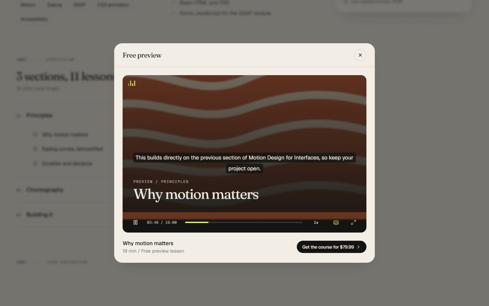
</p>

### Learning paths

Four career paths (Frontend Engineer, Data Analyst, Product Designer and AI Engineer) set out an ordered sequence of courses, with outcomes, weekly time and the roles each path leads to. The cards stack as you scroll, and a whole path can be added to the cart in one click.

<p align="center">
  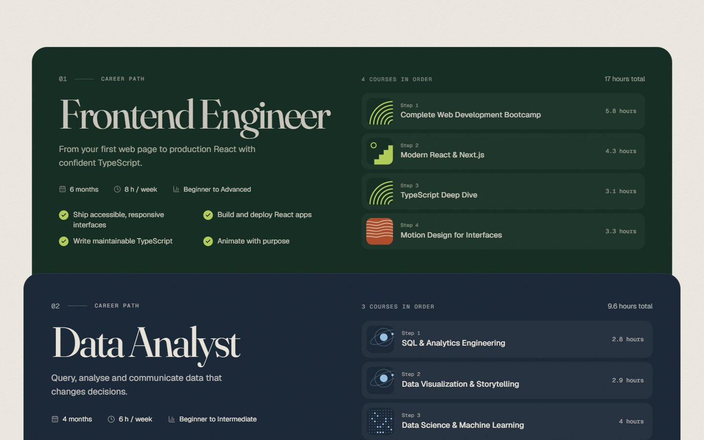
</p>

### Signing in

Real accounts use JWT authentication backed by MongoDB. The demo account sits right on the sign-in page for visitors who just want to look around.

<p align="center">
  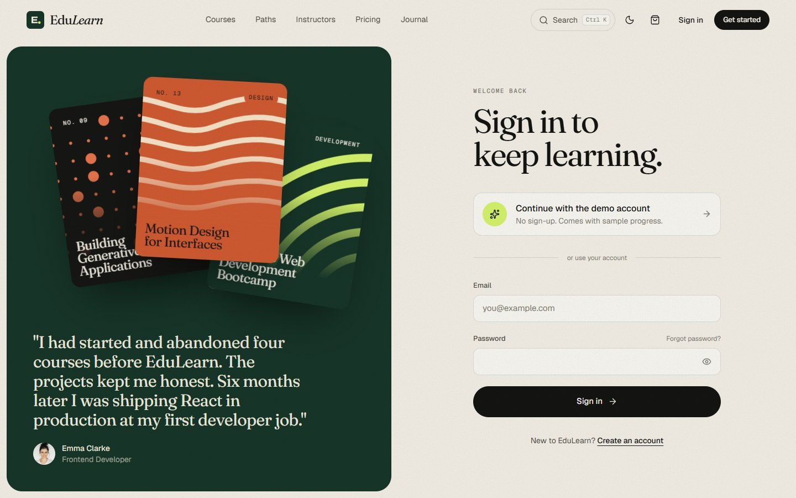
</p>

### The dashboard

The dashboard brings everything together: streak, time learned, completed courses and certificates, a "continue where you left off" card, an adjustable weekly goal with a this-week chart, a 12-week activity heatmap with tooltips, recommendations, and tabs for courses in progress, completed courses, the wishlist and orders.

<table>
  <tr>
    <td width="50%">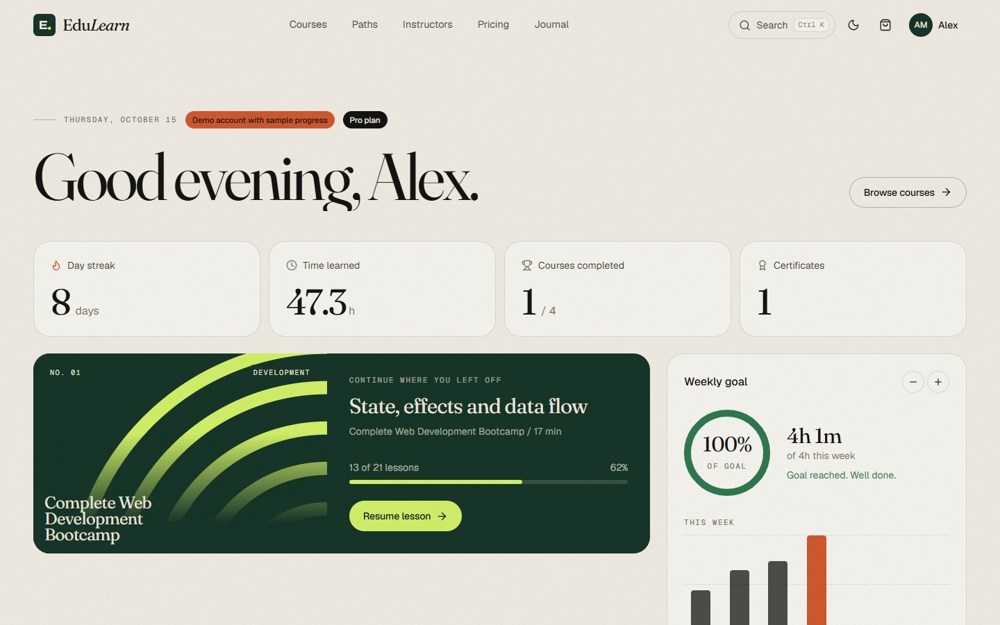</td>
    <td width="50%">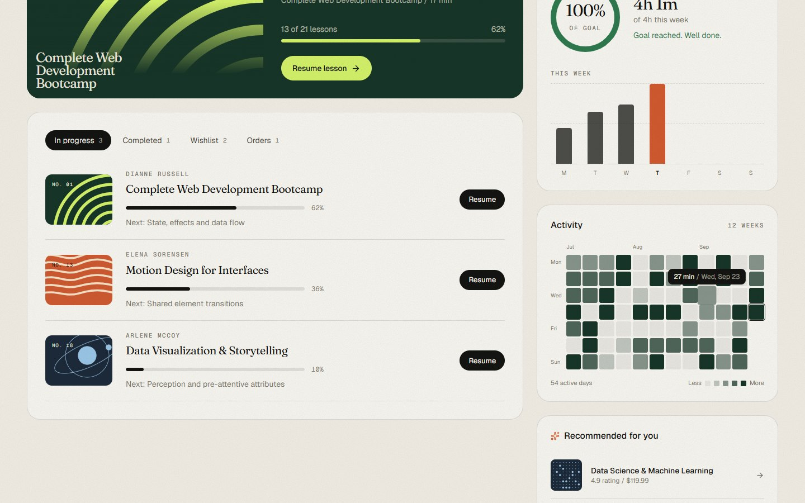</td>
  </tr>
  <tr>
    <td><sub>Stats, the continue-learning card and the weekly goal.</sub></td>
    <td><sub>Courses in progress, this week's chart and the activity heatmap.</sub></td>
  </tr>
</table>

### The classroom

Lessons open in a focused classroom with the full curriculum alongside. Video lessons play in the simulated player, reading lessons render as articles, and project lessons come with a checklist to tick off before submitting. Notes save automatically as you type, and <kbd>Alt</kbd> + arrow keys move between lessons.

Each course ends with a knowledge check. Every answer comes with an explanation, and passing it completes the course.

<table>
  <tr>
    <td width="50%">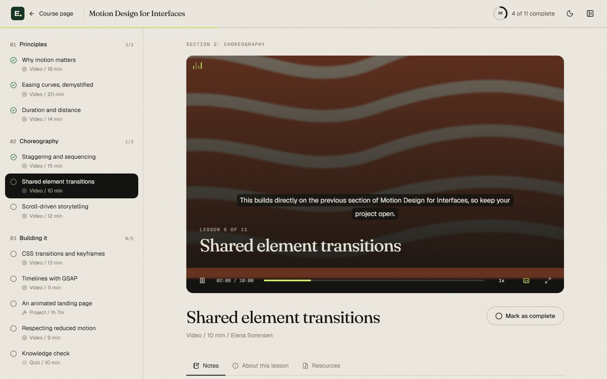</td>
    <td width="50%">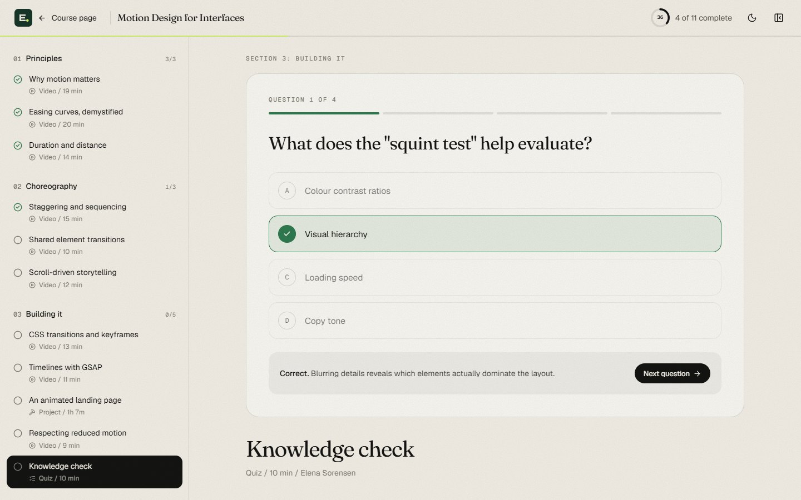</td>
  </tr>
  <tr>
    <td><sub>Lesson player with captions, progress and the curriculum sidebar.</sub></td>
    <td><sub>Knowledge check with instant feedback and an explanation.</sub></td>
  </tr>
</table>

### Checkout

The cart supports coupon codes (`LEARN20` and `FIRSTCLASS`) and saving courses for later. The demo checkout has a live card preview that flips to show the CVV, Luhn and expiry validation, and UPI and PayPal options. **No payment is ever processed**, and the test card `4242 4242 4242 4242` works with any future date.

<p align="center">
  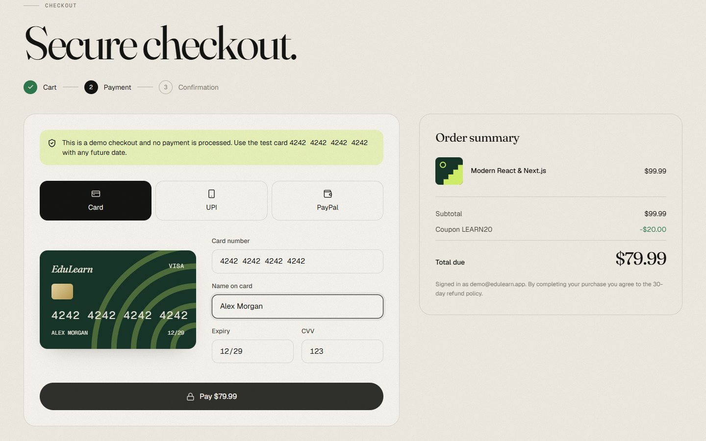
</p>

### Certificates

Completing every lesson and the knowledge check unlocks a certificate with a unique verification ID. It can be printed or saved as a PDF.

<p align="center">
  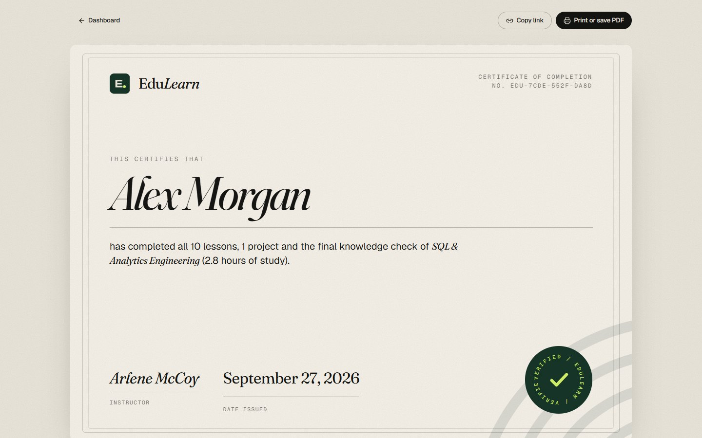
</p>

### Light and dark

Both themes are designed rather than inverted. Switching plays a circular wipe that starts at the toggle, and the choice is remembered for each visitor.

<table>
  <tr>
    <td width="50%">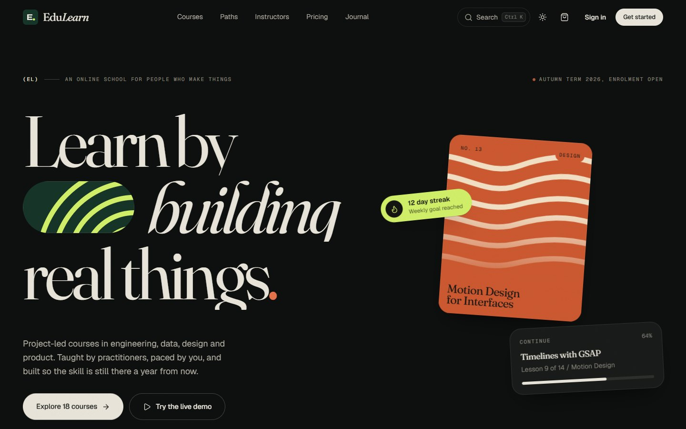</td>
    <td width="50%">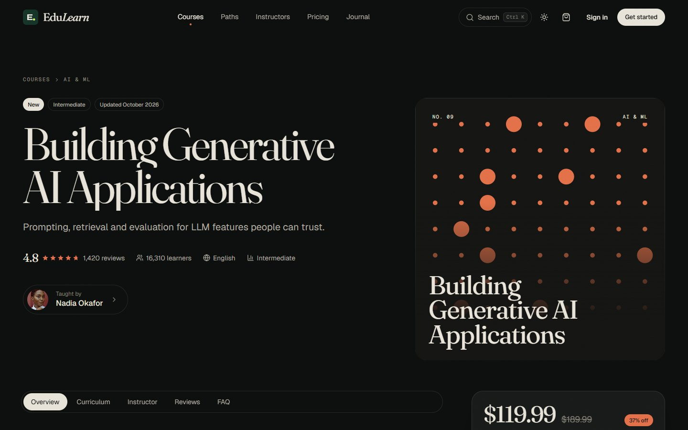</td>
  </tr>
</table>

Beyond these screens there are also instructor profiles, a pricing page with monthly and yearly billing, journal articles with a reading progress bar, about and contact pages, a profile area with avatar cropping, and a custom 404 page.

---

## Under the hood

**Motion system**
- Lenis smooth scrolling runs on GSAP's ticker, so ScrollTrigger always reads the same scroll position
- A two-phase page transition intercepts internal link clicks: a curtain covers the old page, the route changes, then the curtain lifts and the new page's entrance plays
- A small declarative layer (`data-split`, `data-reveal`, `data-stagger`, `data-parallax`) wires scroll animations without per-page boilerplate
- SplitText line reveals, Flip layout animation, pinned horizontal scrolling, magnetic buttons and a velocity-aware marquee
- Every animation respects `prefers-reduced-motion`

**State and data**
- Auth, learning progress, theme and toasts each live in their own React context
- Learning state (enrolments, progress, notes, quiz scores, wishlist, cart, orders, activity) is stored per account and synced to MongoDB with a debounced save for signed-in users
- Guest carts and wishlists move into the account on sign-in, and the demo account is seeded with realistic sample data
- Routes are code-split with `React.lazy`, and protected pages redirect to sign-in and back

**Backend**
- Express 5 API with JWT authentication, bcrypt password hashing and input validation
- Exports the app for Vercel's Node runtime and reuses one MongoDB connection across invocations
- CORS is limited to an allow-list of frontend origins

---

## Tech stack

| Layer | Tools |
| --- | --- |
| Frontend | React 19, React Router 8, Vite 8, Tailwind CSS 4 |
| Motion | GSAP 3 (ScrollTrigger, SplitText, Flip), @gsap/react, Lenis |
| UI | lucide-react, react-easy-crop, Fontsource (Fraunces, Geist, Geist Mono) |
| Backend | Node.js, Express 5, Mongoose 9, JSON Web Tokens, bcryptjs |
| Hosting | Vercel (frontend and backend as separate projects) |

---

## Getting started

Requires Node.js 22.12 or newer.

### Backend

```sh
cd backend
npm install
cp .env.example .env   # then fill in MONGO_URI and JWT_SECRET
npm run dev
```

### Frontend

```sh
cd frontend
npm install
cp .env.example .env   # VITE_API_URL=http://localhost:5000
npm run dev
```

The frontend also runs without a backend. Leave `VITE_API_URL` empty and use the demo account.

### Environment variables

**Backend**
- `MONGO_URI`: MongoDB connection string
- `JWT_SECRET`: secret used to sign tokens
- `PORT`: optional, defaults to 5000
- `CLIENT_ORIGINS`: comma-separated list of allowed frontend origins, defaults to the production site and `http://localhost:5173`

**Frontend**
- `VITE_API_URL`: base URL of the API, without a trailing slash

---

## API

| Method | Route | Description |
| --- | --- | --- |
| POST | `/api/auth/signup` | Create an account |
| POST | `/api/auth/login` | Sign in and receive a token |
| GET | `/api/profile` | Current profile |
| PUT | `/api/profile` | Update name and headline |
| PUT | `/api/profile/image` | Update avatar |
| PUT | `/api/profile/password` | Change password |
| POST | `/api/profile/purchase` | Record purchased course ids |
| GET / PUT | `/api/profile/learning` | Read or save learning progress |
| GET | `/api/health` | Health check |

---

## Deployment

- Deploy `frontend/` and `backend/` as separate Vercel projects.
- `frontend/vercel.json` rewrites every route to `index.html`, so deep links such as `/courses/modern-react-nextjs` load directly.
- Set `MONGO_URI`, `JWT_SECRET` and, if needed, `CLIENT_ORIGINS` on the backend project, and `VITE_API_URL` on the frontend project.

---

## Project structure

```
backend/
  index.js            Express app, CORS, connection handling
  models/User.js
  routes/             auth and profile routes
frontend/
  src/
    components/       layout, ui, course, home, dashboard, auth
    context/          auth, learning, theme, toast providers
    data/             courses, instructors, paths, quizzes, articles
    hooks/            scroll reveal, page title, context hooks
    lib/              gsap setup, api client, pricing, formatting
    pages/            one file per route
    styles/index.css  design tokens and utilities
docs/screenshots/     images used in this README
```

---

## Credits

Photography from [Unsplash](https://unsplash.com). Course covers are generated in code.

Designed and built by Md Rizwan Molla: [X](https://x.com/MdRizwanMolla), [LinkedIn](https://www.linkedin.com/in/rizwan-molla/).

Licensed under the MIT License.
